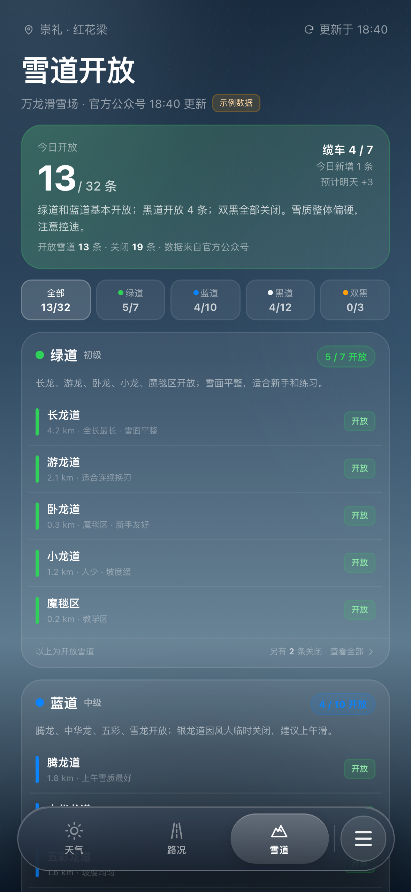

# 滑雪天气通

崇礼 / 金山岭 **8 家雪场**的天气、路况、雪道开放与每日滑雪建议，为 iPhone 设计的 PWA。

- 线上地址：<https://dong20000817-cmd.github.io/chongli-snow/>
- 雪场：万龙、云顶、太舞、富龙、翠云山银河、多乐美地、雪如意、金山岭银河
- 天气数据：Open-Meteo（CC BY 4.0），浏览器直接取数，不需要 Mac 开机
- 雪道 / 路况：人工维护 JSON（见下文），不是官方实时 API
- 技术：Vite + React + TypeScript + PWA，GitHub Pages 托管

## 怎么看

线上已部署，iPhone 直接打开即可；断网刷新仍会显示最后一次缓存，并出现“离线”提示。

iPhone Safari 打开线上地址：

1. 点“分享”
2. 选“添加到主屏幕”
3. 之后从桌面打开就是全屏 App；断网时会显示最后一次缓存

## 功能

- 三个模块：天气 / 路况 / 雪道，底部 iOS 气泡导航
- 当前天气：雪场天气、能见度、山顶/山底温度、体感、风向、风速、风级
- **风力小时图**：24 / 48 / 72 小时，柱=持续风，虚线=阵风，箭头=风向
- 6 级“缆车可能降速”与 8 级“可能停运”警戒线
- 四档每日建议：非常建议 / 一般建议 / 不太建议 / 地狱难度
- 建议依据：风力、能见度、体感、缆车风险四因素 + 更好时段
- 未来 7 天每日建议 + 本周最佳
- 路况：京礼、京藏+张承、京新+张承三条路线，封路路段、预计恢复、绕行、沿线能见度
- 雪道：按绿道/蓝道/黑道/双黑分类列表，开放雪道、关闭数量、未来 3 天预计
- 开发者简报：`#/dev`，每天 07:30 可导出天气 / 雪道 / 路况三张 1080×1440 图 + 小红书文案
- 底部导航右侧圆形按钮：天气/雪道切换雪场，路况切换路线；记住上次选择
- 离线缓存 / 15 分钟自动刷新 / 回到前台刷新

## 开发者简报（每天 07:30）

打开 <https://dong20000817-cmd.github.io/chongli-snow/#/dev>，或从任意模块页脚点“开发者”。

页面包含：

1. **天气图**：8 家雪场今日/明日滑雪指数，按分数排序。
2. **雪道图**：新增开放、临时关闭、预计开放。
3. **路况图**：三条路线状态、封路路段、绕行、沿线能见度。
4. **文案**：一键复制小红书风格文案。

每张图 540×720 CSS 像素，导出为 **1080×1440 PNG**（3:4），适合小红书竖版。iPhone 上点“保存 / 分享图片”会优先调起系统分享；没有分享能力时下载图片，可在新窗口或下载项中长按保存。

开发者页是公开路由，不包含账号、密钥或私人数据。

## 数据口径

- 山顶、山底使用同一模式格点按海拔订正，不是山顶实测站。
- 能见度、体感、风都取**山顶**，安全优先。
- 缆车风险是天气估算，不是雪场官方运营公告。
- 仅评估日间 08:00–17:00；夜场需另看晚间风力。
- 当前天气是模式预报，不是气象站实况；页面标“预报非实况”。
- 附近雪场可能落在同一模式格点，风力会显示相同；这是模式分辨率限制，不是 bug。

### 建议规则

按“从坏到好”顺序命中：

| 等级 | 条件 |
|---|---|
| 地狱难度 | 能见度 <0.5km；或持续风 ≥50km/h；或阵风 ≥75km/h；或体感 ≤-30°；或雷暴/冻雨；或缆车可能停运 |
| 不太建议 | 能见度 <2km；或持续风 ≥39km/h；或阵风 ≥60km/h；或体感 ≤-26°；或缆车可能降速 |
| 非常建议 | 能见度 ≥5km 且持续风 ≤28km/h 且阵风 <45km/h 且体感 ≥-20° 且降雪 ≤2cm/h 且无雾/雷暴 |
| 一般建议 | 其余 |

日建议按 08:00–17:00 逐小时分级：地狱 ≥2 小时→地狱；不太+地狱 ≥3 小时→不太建议；非常建议 ≥5 小时且无不太/地狱→非常建议；否则一般建议。

## 为什么不用 Windy 数字接口

Windy Point Forecast 的全球模式（gfs/icon）不提供 visibility，且不含 ECMWF；生产接口为付费订阅，测试 key 返回打乱的数据。静态 GitHub Pages 也无法安全保存 API key。

因此数字天气使用 Open-Meteo，Windy 只作为风力详情页的“风场动画”外链。若以后有付费 key，可加 Cloudflare Worker 代理，不需要改前端结构。

## 路况 / 雪道数据怎么更新

路况和雪道状态没有稳定的公开实时 API，当前用两个 JSON 维护：

- `src/data/road.json`：三条路线、封路段、能见度、来源
- `src/data/snow.json`：8 家雪场的分类、开放雪道、未来 3 天预计、变化摘要

更新方式：

1. 在 GitHub 打开对应文件，点编辑（手机也可以）。
2. 修改 `updatedAt`、状态、封路/开放信息、来源和时间。
3. 提交后 GitHub Actions 自动重新构建并发布。
4. 第二天早上 07:30 打开 `#/dev`，刷新天气，导出三张图。

页面会在数据不是当天时显示“非今日数据”，在演示数据时显示“示例数据”。正式发布前请把示例数据替换为官方公众号/公告核验后的内容。

## 本地开发

```bash
pnpm install
pnpm dev          # http://127.0.0.1:5173
pnpm test
pnpm build
pnpm preview      # http://127.0.0.1:4173
```

## 部署

仓库 push 到 `main` 后，GitHub Actions 会：

1. 安装依赖
2. 跑 Vitest
3. `vite build`
4. 把 `dist/` 发布到 GitHub Pages

前提：仓库 Settings → Pages → Source 选择 **GitHub Actions**。

仓库地址：<https://github.com/dong20000817-cmd/chongli-snow>

## 目录

```text
src/
  data/resorts.ts        # 8 家雪场坐标/海拔，加雪场只改这里
  data/road.json         # 路况：三条路线、封路、能见度
  data/snow.json         # 雪道：8 家雪场分类/开放/预计
  lib/api.ts             # Open-Meteo 请求 + 归一化
  lib/recommend.ts       # 四档建议、日聚合、更好时段
  lib/status.ts          # 路况/雪道类型与数据
  lib/digest.ts          # 开发者简报三张图的数据和文案
  components/            # 图表、卡片、抽屉、DigestCards
  screens/               # 天气、路况、雪道、开发者简报
  styles/app.css         # 设计系统
mockups/                 # 确认过的效果图（设计存档）
docs/preview/            # 线上截图
```

## 截图

| | |
|---|---|
|  |  |
|  |  |
|  |  |

## 已知边界

- 天气模式格点较粗，山脊实际风可能更大。
- 能见度是模式预报，雾/雪团可能局地突变。
- 雪道开放、雪质、缆车状态来自公众号/公告人工整理，不是官方实时 API；以雪场当日公告为准。
- Open-Meteo / GitHub Pages 在国内偶发访问不稳定；已做缓存，必要时可迁 Cloudflare Pages。
- 仅个人非商业使用；天气数据遵循 CC BY 4.0，页面已署名。
