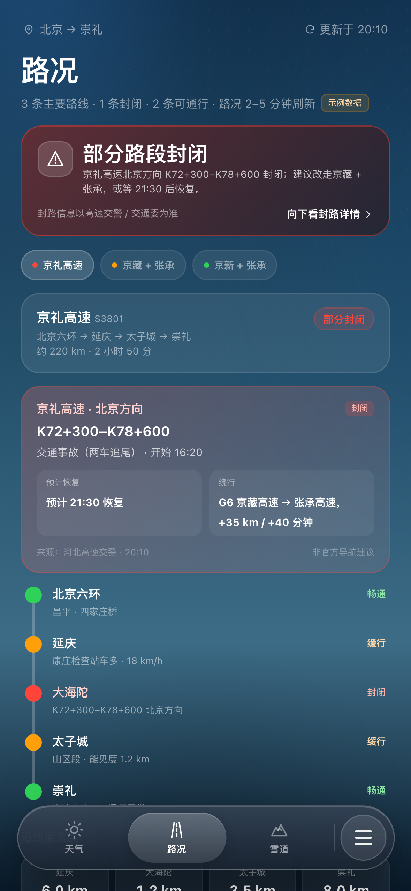
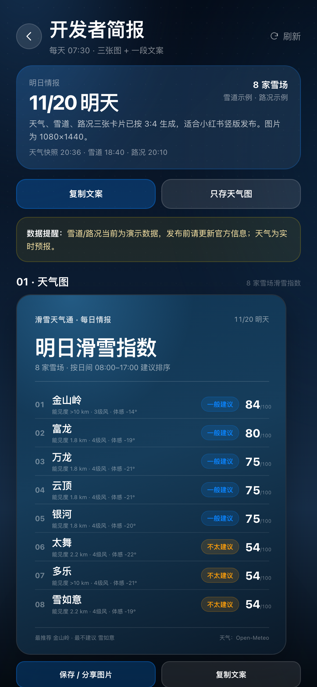
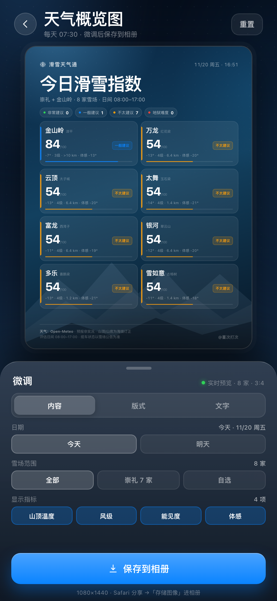
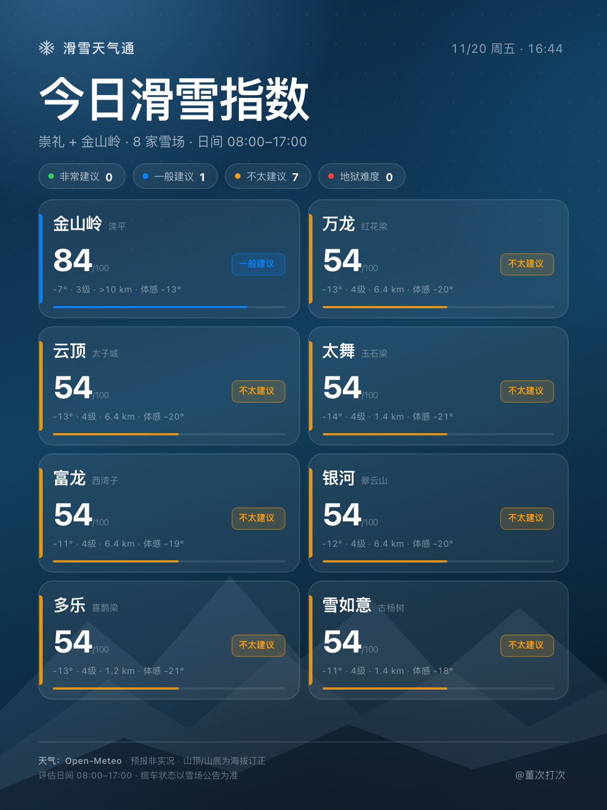
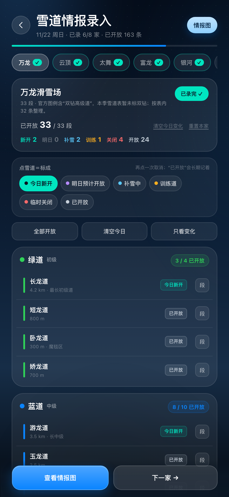

# 滑雪天气通

崇礼 / 金山岭 **8 家雪场**的天气、路况、雪道开放与每日滑雪建议，为 iPhone 设计的 PWA。

- 线上地址（固定，只收藏这一个）：<https://dong20000817-cmd.github.io/chongli-snow/>
- 雪场：万龙、云顶、太舞、富龙、翠云山银河、多乐美地、雪如意、金山岭银河
- 天气数据：Open-Meteo（CC BY 4.0），浏览器直接取数，不需要 Mac 开机
- 雪道 / 路况：人工维护 JSON（见下文），不是官方实时 API
- 技术：Vite + React + TypeScript + PWA，GitHub Pages 托管

## 只有一个网址

固定地址：<https://dong20000817-cmd.github.io/chongli-snow/>

每次部署只更新这一个站，**不会换域名，也不会新建站点**。`#/poster`、`#/trails`、`#/trailposter` 只是同一个 App 里的页面，`#` 后面的部分不会产生新网站。

首页右上角有两个小图标：图片是「天气概览图」，四个方块是「所有工具」——里面就是全部入口：

- 天气概览图 `#/poster`
- 雪道录入 `#/trails`
- 雪道情报图 `#/trailposter`
- 开发者简报 `#/dev`
- 版本号 + 「检查更新」

收藏根地址就够了；以后加功能也只会出现在「所有工具」里，不需要换链接。部署后 Service Worker 会自动更新并刷新一次；如果没生效，点「检查更新」。

## 怎么看

线上已部署，iPhone 直接打开即可；断网刷新仍会显示最后一次缓存，并出现“离线”提示。

iPhone Safari 打开线上地址：

1. 点“分享”
2. 选“添加到主屏幕”
3. 之后从桌面打开就是全屏 App；断网时会显示最后一次缓存

## 功能

- 三个模块：天气 / 路况 / 雪道，底部 iOS 气泡导航
- 当前天气：雪场天气、能见度、山顶/山底温度、体感、风向、风速、风级
- **风力小时图**：24 / 48 / 72 小时，柱=持续风，虚线=阵风，箭头=风向
- 6 级“缆车可能降速”与 8 级“可能停运”警戒线
- 四档每日建议：非常建议 / 一般建议 / 不太建议 / 地狱难度
- 建议依据：风力、能见度、体感、缆车风险四因素 + 更好时段
- 未来 7 天每日建议 + 本周最佳
- 路况：京礼、京藏+张承、京新+张承三条路线，封路路段、预计恢复、绕行、沿线能见度
- 雪道：8 家雪场 **191 条完整雪道清单**（绿 / 蓝 / 红 / 黑，红道仅雪如意），按难度分组
- 雪道情报录入：`#/trails`，每天手动标「今日新开 / 明日预计 / 补雪 / 训练 / 临时关闭 / 开放」，一家约 30 秒
- 雪道情报图：`#/trailposter`，把 8 家的标注汇总成 3:4 / 9:16 日报图
- 开发者简报：`#/dev`，每天 07:30 可导出天气 / 雪道 / 路况 + 雪道情报图（1080×1440）+ 小红书文案
- 天气概览图：`#/poster`，双列/榜单/单雪场三版式，3:4 与 9:16，微调后保存到手机相册
- 底部导航右侧圆形按钮：天气/雪道切换雪场，路况切换路线；记住上次选择
- 离线缓存 / 15 分钟自动刷新 / 回到前台刷新

## 开发者简报（每天 07:30）

打开 <https://dong20000817-cmd.github.io/chongli-snow/#/dev>，或从任意模块页脚点“开发者”。

页面包含：

1. **天气图**：8 家雪场今日/明日滑雪指数，按分数排序。
2. **雪道图**：新增开放、临时关闭、预计开放。
3. **路况图**：三条路线状态、封路路段、绕行、沿线能见度。
4. **文案**：一键复制小红书风格文案。

每张图 540×720 CSS 像素，导出为 **1080×1440 PNG**（3:4），适合小红书竖版。iPhone 上点“保存 / 分享图片”会优先调起系统分享；没有分享能力时下载图片，可在新窗口或下载项中长按保存。

开发者页是公开路由，不包含账号、密钥或私人数据。

## 天气概览图（每天 07:30）

打开 <https://dong20000817-cmd.github.io/chongli-snow/#/poster>，或在天气首页点右上角小图标、在开发者简报首屏点「天气概览图」。

- 默认 **双列版**，8 家雪场按滑雪指数排序。
- 默认显示：山顶温度、风级、能见度、体感。
- 可切 **今天 / 明天**、全部 8 家 / 崇礼 7 家 / 自选雪场。
- 版式：双列 / 榜单 / 单雪场；主题：雪夜 / 晨光 / 雾雪。
- 尺寸：**3:4（1080×1440）** 和 **9:16（1080×1920）**。
- 文字：主标题、副标题、署名，默认 `@董次打次`。
- 版式、尺寸、主题、指标开关、雪场范围会记在 `localStorage`。

保存流程：点「保存到相册」→ 生成 PNG → iOS 系统分享 → 点「存储图像」→ 进入「照片」。  
Safari 不允许网页静默写入相册，所以需要这一步确认；没有分享能力时会回退为下载 PNG。

## 雪道情报（手动录入 → 自动摘要图）

雪道没有稳定的官方实时接口，所以改成**一次把清单做好，每天只点状态**。

### 1. 雪道清单（已内置）

`src/data/trails.json`，2026-27 雪季，按各雪场官方雪道图 / 公开雪道参数表整理：

| 雪场 | 条数 | 难度构成 | 说明 |
|---|---:|---|---|
| 万龙 | 32 | 绿 4 · 蓝 9 · 黑 19 | 官方图例有“双钻高级道”符号，但本季雪道表没有雪道标双钻 |
| 云顶 | 32 | 绿 3 · 蓝 16 · 黑 13 | 另有 7 处地形公园 / 赛事场地未计入 |
| 太舞 | 22 | 绿 5 · 蓝 11 · 黑 6 | 全部以舞蹈命名 |
| 富龙 | 33 | 绿 8 · 蓝 9 · 黑 16 | 含 1 条初中级、2 条地形公园 |
| 翠云山银河 | 12 | 绿 4 · 蓝 5 · 黑 3 | 12 星座命名 |
| 多乐美地 | 9 | 绿 1 · 蓝 5 · 黑 3 | 意大利城市命名，含 2 条公园/树林道 |
| 雪如意 | 31 | 绿 9 · 蓝 15 · **红 4 · 黑 3** | 唯一用红道的雪场；红道 A3/A5/B9/C5，黑道 D2/D3/D5 是最高级 |
| 金山岭银河 | 20 | 绿 3 · 蓝 5 · 黑 12 | 已建成 20 条，规划 31 条；星辰命名 |

合计 **191 条**。清单里的长度、难度来自官方图/参数表，**开放状态永远以你在 App 里的当天标注为准**。

### 2. 每天怎么录

1. 打开 <https://dong20000817-cmd.github.io/chongli-snow/#/trails>（雪道页也有「去录入」入口）。
2. 选雪场 → 点「全部开放」→ 选一种状态（如「补雪中」）→ 点对应雪道。
3. 补雪、训练、临时关闭同理；点第二下取消。
4. 点「录完 · 下一家」，8 家录完进度到 8/8。
5. 点「查看情报图」→ 选 3:4 / 9:16 → 保存到相册。

规则：

- 标注只存在**浏览器 localStorage**，按日期分开存，不上传服务器。
- 昨天的「明日预计」会在第二天自动变成「今日新开」；补雪/训练/关闭不继承。
- 没有标注的雪道显示「未标」，不会假装是开放。
- 中途隔了几天没录，不会跨天乱顺延。

### 3. 摘要图

`#/trailposter`：8 家雪场一家一行，含新开/补雪/训练/关闭的数量和雪道名，顶部是全场汇总，底部是「人工录入 · 以雪场当日公告为准」。支持 **3:4（1080×1440）** 与 **9:16（1080×1920）**，保存流程与天气概览图一致（系统分享 → 存储图像）。

开发者简报里它是 **04 · 雪道情报图**；02 雪道图也改为读同一份手动标注，不再使用演示数据。

## 数据口径

- 山顶、山底使用同一模式格点按海拔订正，不是山顶实测站。
- 能见度、体感、风都取**山顶**，安全优先。
- 缆车风险是天气估算，不是雪场官方运营公告。
- 仅评估日间 08:00–17:00；夜场需另看晚间风力。
- 当前天气是模式预报，不是气象站实况；页面标“预报非实况”。
- 附近雪场可能落在同一模式格点，风力会显示相同；这是模式分辨率限制，不是 bug。

### 建议规则

按“从坏到好”顺序命中：

| 等级 | 条件 |
|---|---|
| 地狱难度 | 能见度 <0.5km；或持续风 ≥50km/h；或阵风 ≥75km/h；或体感 ≤-30°；或雷暴/冻雨；或缆车可能停运 |
| 不太建议 | 能见度 <2km；或持续风 ≥39km/h；或阵风 ≥60km/h；或体感 ≤-26°；或缆车可能降速 |
| 非常建议 | 能见度 ≥5km 且持续风 ≤28km/h 且阵风 <45km/h 且体感 ≥-20° 且降雪 ≤2cm/h 且无雾/雷暴 |
| 一般建议 | 其余 |

日建议按 08:00–17:00 逐小时分级：地狱 ≥2 小时→地狱；不太+地狱 ≥3 小时→不太建议；非常建议 ≥5 小时且无不太/地狱→非常建议；否则一般建议。

## 为什么不用 Windy 数字接口

Windy Point Forecast 的全球模式（gfs/icon）不提供 visibility，且不含 ECMWF；生产接口为付费订阅，测试 key 返回打乱的数据。静态 GitHub Pages 也无法安全保存 API key。

因此数字天气使用 Open-Meteo，Windy 只作为风力详情页的“风场动画”外链。若以后有付费 key，可加 Cloudflare Worker 代理，不需要改前端结构。

## 路况 / 雪道数据怎么更新

- **雪道**：清单在 `src/data/trails.json`，状态在 App 内手动录入（`#/trails`），不需要改代码；换雪季要更新清单时，改这个 JSON 即可。
- **路况**：`src/data/road.json` 维护三条路线、封路段、能见度、来源；改完提交，GitHub Actions 自动重新构建发布。
- **天气**：Open-Meteo 实时请求，不需要人工维护。

页面会在路况不是当天时显示“非今日数据”，演示路况显示“示例数据”。雪道页显示的是“人工录入 / 待录入”，不会把未录入说成开放。

## 本地开发

```bash
pnpm install
pnpm dev          # http://127.0.0.1:5173
pnpm test
pnpm build
pnpm preview      # http://127.0.0.1:4173
```

## 部署

仓库 push 到 `main` 后，GitHub Actions 会：

1. 安装依赖
2. 跑 Vitest
3. `vite build`
4. 把 `dist/` 发布到 GitHub Pages

前提：仓库 Settings → Pages → Source 选择 **GitHub Actions**。

仓库地址：<https://github.com/dong20000817-cmd/chongli-snow>

## 目录

```text
src/
  data/resorts.ts        # 8 家雪场坐标/海拔，加雪场只改这里
  data/road.json         # 路况：三条路线、封路、能见度
  data/trails.json       # 雪道全清单：8 家 191 条，名称/难度/长度
  lib/api.ts             # Open-Meteo 请求 + 归一化
  lib/recommend.ts       # 四档建议、日聚合、更好时段
  lib/status.ts          # 路况类型与数据
  lib/trails.ts          # 雪道清单、每日标注、跨天顺延、摘要数据
  lib/digest.ts          # 开发者简报三张图的数据和文案
  lib/poster.ts          # 天气概览图数据、设置、持久化
  lib/export.ts          # PNG 生成后的分享/下载
  components/            # 图表、卡片、抽屉、DigestCards、PosterCard
  screens/               # 天气、路况、雪道、雪道录入、雪道情报图、开发者简报、天气概览图
  styles/app.css         # 设计系统
  styles/poster.css      # 概览图海报与编辑器
  styles/trails.css      # 雪道录入与雪道情报图
mockups/                 # 确认过的效果图（设计存档）
docs/preview/            # 线上截图
```

## 截图

| | |
|---|---|
|  |  |
|  |  |
|  |  |
|  |  |
|  |  |

## 已知边界

- 天气模式格点较粗，山脊实际风可能更大。
- 能见度是模式预报，雾/雪团可能局地突变。
- 雪道清单来自官方雪道图/公开参数表，可能与现场临时调整不一致；开放状态是你手动标注的，不是官方实时 API。
- 雪道标注只在本机浏览器，换手机/清缓存会丢；不跨设备同步。
- 金山岭已建成 20 条（规划 31 条）；万龙图例有“双钻高级道”但本季没有雪道标为双钻。
- Open-Meteo / GitHub Pages 在国内偶发访问不稳定；已做缓存，必要时可迁 Cloudflare Pages。
- 仅个人非商业使用；天气数据遵循 CC BY 4.0，页面已署名。
