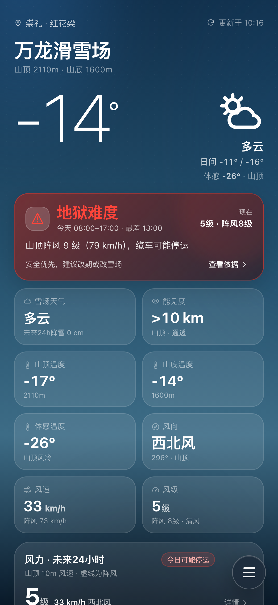
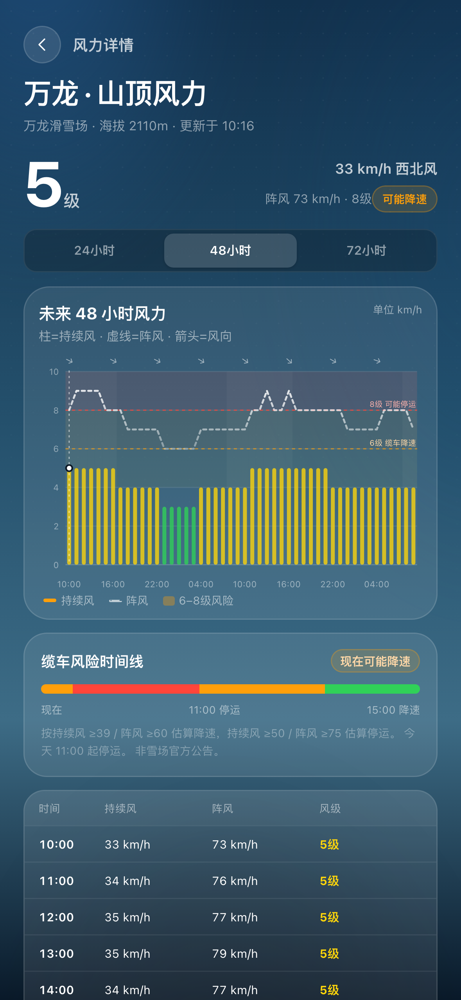
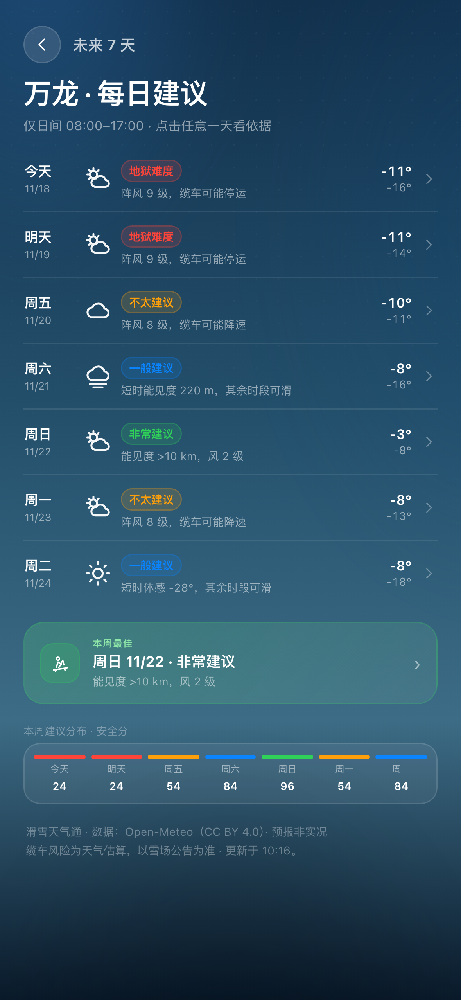
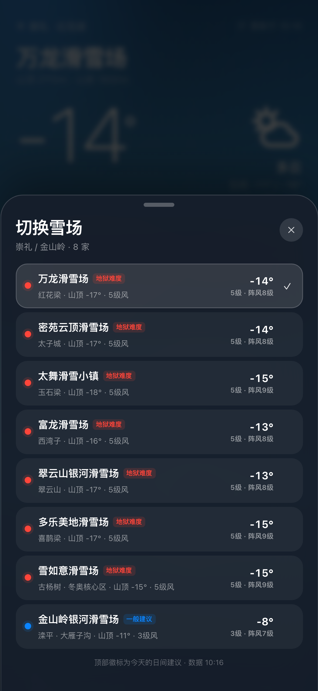

# 滑雪天气通

崇礼 / 金山岭 **8 家雪场**的实时天气、风力和每日滑雪建议，为 iPhone 设计的 PWA。

- 线上地址（部署后）：<https://dong20000817-cmd.github.io/chongli-snow/>
- 雪场：万龙、云顶、太舞、富龙、翠云山银河、多乐美地、雪如意、金山岭银河
- 数据：Open-Meteo（CC BY 4.0），浏览器直接取数，不需要 Mac 开机
- 技术：Vite + React + TypeScript + PWA，GitHub Pages 托管

## 怎么看

iPhone Safari 打开线上地址：

1. 点“分享”
2. 选“添加到主屏幕”
3. 之后从桌面打开就是全屏 App；断网时会显示最后一次缓存

## 功能

- 当前天气：雪场天气、能见度、山顶/山底温度、体感、风向、风速、风级
- **风力小时图**：24 / 48 / 72 小时，柱=持续风，虚线=阵风，箭头=风向
- 6 级“缆车可能降速”与 8 级“可能停运”警戒线
- 四档每日建议：非常建议 / 一般建议 / 不太建议 / 地狱难度
- 建议依据：风力、能见度、体感、缆车风险四因素 + 更好时段
- 未来 7 天每日建议 + 本周最佳
- 右下角三条横线切换雪场；记住上次选择
- 离线缓存 / 15 分钟自动刷新 / 回到前台刷新

## 数据口径

- 山顶、山底使用同一模式格点按海拔订正，不是山顶实测站。
- 能见度、体感、风都取**山顶**，安全优先。
- 缆车风险是天气估算，不是雪场官方运营公告。
- 仅评估日间 08:00–17:00；夜场需另看晚间风力。
- 当前天气是模式预报，不是气象站实况；页面标“预报非实况”。
- 附近雪场可能落在同一模式格点，风力会显示相同；这是模式分辨率限制，不是 bug。

### 建议规则

按“从坏到好”顺序命中：

| 等级 | 条件 |
|---|---|
| 地狱难度 | 能见度 <0.5km；或持续风 ≥50km/h；或阵风 ≥75km/h；或体感 ≤-30°；或雷暴/冻雨；或缆车可能停运 |
| 不太建议 | 能见度 <2km；或持续风 ≥39km/h；或阵风 ≥60km/h；或体感 ≤-26°；或缆车可能降速 |
| 非常建议 | 能见度 ≥5km 且持续风 ≤28km/h 且阵风 <45km/h 且体感 ≥-20° 且降雪 ≤2cm/h 且无雾/雷暴 |
| 一般建议 | 其余 |

日建议按 08:00–17:00 逐小时分级：地狱 ≥2 小时→地狱；不太+地狱 ≥3 小时→不太建议；非常建议 ≥5 小时且无不太/地狱→非常建议；否则一般建议。

## 为什么不用 Windy 数字接口

Windy Point Forecast 的全球模式（gfs/icon）不提供 visibility，且不含 ECMWF；生产接口为付费订阅，测试 key 返回打乱的数据。静态 GitHub Pages 也无法安全保存 API key。

因此数字天气使用 Open-Meteo，Windy 只作为风力详情页的“风场动画”外链。若以后有付费 key，可加 Cloudflare Worker 代理，不需要改前端结构。

## 本地开发

```bash
pnpm install
pnpm dev          # http://127.0.0.1:5173
pnpm test
pnpm build
pnpm preview      # http://127.0.0.1:4173
```

## 部署

仓库 push 到 `main` 后，GitHub Actions 会：

1. 安装依赖
2. 跑 Vitest
3. `vite build`
4. 把 `dist/` 发布到 GitHub Pages

前提：仓库 Settings → Pages → Source 选择 **GitHub Actions**。

仓库地址：<https://github.com/dong20000817-cmd/chongli-snow>

## 目录

```text
src/
  data/resorts.ts        # 8 家雪场坐标/海拔，加雪场只改这里
  lib/api.ts             # Open-Meteo 请求 + 归一化
  lib/recommend.ts       # 四档建议、日聚合、更好时段
  lib/wind.ts            # 蒲福风级、缆车风险
  lib/time.ts            # 亚洲上海时区/日间窗口
  components/            # 图表、卡片、抽屉
  screens/               # 首页、风力详情、7 天
  styles/app.css         # 设计系统
mockups/                 # 确认过的效果图（设计存档）
docs/preview/            # 线上截图
```

## 截图

| | |
|---|---|
|  |  |
|  |  |

## 已知边界

- 天气模式格点较粗，山脊实际风可能更大。
- 能见度是模式预报，雾/雪团可能局地突变。
- 不提供雪场官方雪道开放、雪质、缆车实时状态。
- Open-Meteo / GitHub Pages 在国内偶发访问不稳定；已做缓存，必要时可迁 Cloudflare Pages。
- 仅个人非商业使用；天气数据遵循 CC BY 4.0，页面已署名。
